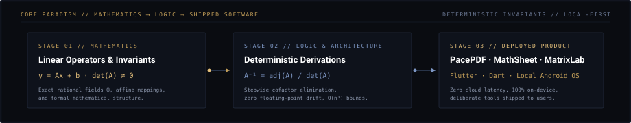
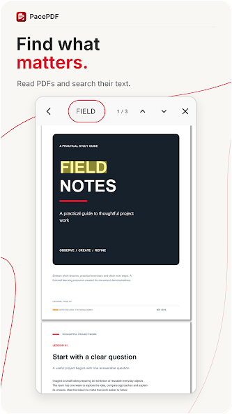
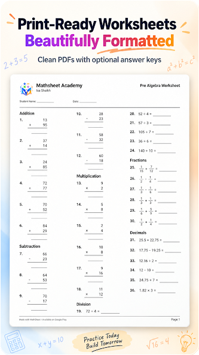
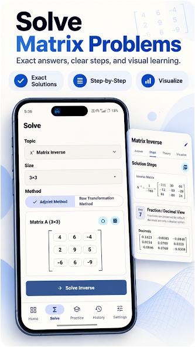

<!-- ═══════════════════════════════════════════════════════════════════ -->
<!-- HERO 2.0: THE MATHEMATICAL CONSTRUCTION                            -->
<!-- ═══════════════════════════════════════════════════════════════════ -->

  <picture>
    <source media="(prefers-color-scheme: dark)" srcset="assets/profile/hero-dark.svg">
    <source media="(prefers-color-scheme: light)" srcset="assets/profile/hero-light.svg">
    
  </picture>

 

<!-- ═══════════════════════════════════════════════════════════════════ -->
<!-- SECTION: ABOUT                                                     -->
<!-- ═══════════════════════════════════════════════════════════════════ -->

<table width="100%">
<tr>
<td style="padding: 20px 24px;">

<h3 style="margin-top: 0; margin-bottom: 8px;">Discipline &amp; Intent</h3>

  I am an engineering student and independent software developer with an enduring focus on mathematics, systems architecture, and mobile engineering.

  Through <strong>Elyaro Labs</strong>, my independent software studio, I design and ship local-first Android applications built for privacy, deterministic execution, and daily utility. I approach software through two complementary disciplines: <strong>mathematical reasoning</strong> to model problems with clarity, and <strong>rigorous software engineering</strong> to translate those models into fast, dependable tools.

</td>
</tr>
</table>

 

<!-- ═══════════════════════════════════════════════════════════════════ -->
<!-- MATHEMATICS × LOGIC × SOFTWARE PIPELINE                            -->
<!-- ═══════════════════════════════════════════════════════════════════ -->

  <picture>
    <source media="(prefers-color-scheme: dark)" srcset="assets/profile/math-core-dark.svg">
    <source media="(prefers-color-scheme: light)" srcset="assets/profile/math-core-light.svg">
    
  </picture>

 

  <picture>
    <source media="(prefers-color-scheme: dark)" srcset="assets/profile/divider-dark.svg">
    <source media="(prefers-color-scheme: light)" srcset="assets/profile/divider-light.svg">
    
  </picture>

 

<!-- ═══════════════════════════════════════════════════════════════════ -->
<!-- SECTION: SELECTED WORKS (AUTHENTIC EDITORIAL SHOWCASES)             -->
<!-- ═══════════════════════════════════════════════════════════════════ -->

<h2>Selected Works</h2>

Three focused Android applications built from first architectural decisions to live production distribution.

 

<!-- ───────────────────────────────────────────────────────────────── -->
<!-- 01 / PACEPDF                                                      -->
<!-- ───────────────────────────────────────────────────────────────── -->

<table width="100%">
<tr>
<td width="66%" valign="top" style="padding: 24px;">

<table border="0" cellpadding="0" cellspacing="0" style="border: none;">
  <tr>
    <td width="96" valign="middle" style="border: none; padding: 0;">
      
    </td>
    <td valign="middle" style="border: none; padding-left: 16px;">
      <h3 style="margin: 0; font-size: 20px;">01 // PacePDF</h3>
      <strong style="color: #E2E8F0; font-size: 14px;">Documents, under control.</strong> 
      Android PDF Reader &amp; On-Device Document Toolkit
    </td>
  </tr>
</table>

  PacePDF integrates fast document viewing, in-document text search, and comprehensive page manipulation into an all-in-one local toolkit engineered without server dependencies.

<ul style="margin: 0; padding-left: 20px; line-height: 1.6; font-size: 13.5px;">
  <li><strong>100% On-Device Processing:</strong> Zero mandatory account registration and zero cloud file uploads—documents never leave local hardware.</li>
  <li><strong>Precision Toolkit:</strong> Merge, split, rotate (90° increments), crop, and visually reorder document pages.</li>
  <li><strong>Security &amp; Conversion:</strong> Password encryption, custom visual signature placement, watermarking, and bi-directional image-to-PDF / PDF-to-image extraction.</li>
</ul>

  <code>Flutter</code> &nbsp;·&nbsp; <code>Dart</code> &nbsp;·&nbsp; <code>Android</code> &nbsp;·&nbsp; <code>On-Device Architecture</code>

</td>
<td width="34%" align="center" valign="middle" style="padding: 20px; background-color: rgba(0,0,0,0.15);">

 
<em>In-Document Search Capture</em>

</td>
</tr>
</table>

 

<!-- ───────────────────────────────────────────────────────────────── -->
<!-- 02 / MATHSHEET                                                    -->
<!-- ───────────────────────────────────────────────────────────────── -->

<table width="100%">
<tr>
<td width="66%" valign="top" style="padding: 24px;">

<table border="0" cellpadding="0" cellspacing="0" style="border: none;">
  <tr>
    <td width="96" valign="middle" style="border: none; padding: 0;">
      
    </td>
    <td valign="middle" style="border: none; padding-left: 16px;">
      <h3 style="margin: 0; font-size: 20px;">02 // MathSheet</h3>
      <strong style="color: #E2E8F0; font-size: 14px;">Practice made deliberate.</strong> 
      Math Practice Drill &amp; Printable PDF Worksheet Generator
    </td>
  </tr>
</table>

  Designed for students, educators, and coaching institutes, MathSheet bridges digital arithmetic drills with high-density, printable mathematical worksheet generation.

<ul style="margin: 0; padding-left: 20px; line-height: 1.6; font-size: 13.5px;">
  <li><strong>Configurable Arithmetic Engine:</strong> Arithmetic operations across customizable difficulty tiers (Easy through Expert), including order of operations (BODMAS), fractions, decimals, and negative numbers.</li>
  <li><strong>Synchronized Answer Keys:</strong> Dynamic PDF generation compiling question sets and matching teacher answer keys with independent or dual-document export.</li>
  <li><strong>Interactive Practice Mode:</strong> On-device practice with timed challenges, instant verification, and weak-spot performance review.</li>
</ul>

  <code>Flutter</code> &nbsp;·&nbsp; <code>Dart</code> &nbsp;·&nbsp; <code>Algorithmic Generation</code> &nbsp;·&nbsp; <code>PDF Vector Engine</code>

</td>
<td width="34%" align="center" valign="middle" style="padding: 20px; background-color: rgba(0,0,0,0.15);">

 
<em>Worksheet Generator Capture</em>

</td>
</tr>
</table>

 

<!-- ───────────────────────────────────────────────────────────────── -->
<!-- 03 / MATRIXLAB                                                    -->
<!-- ───────────────────────────────────────────────────────────────── -->

<table width="100%">
<tr>
<td width="66%" valign="top" style="padding: 24px;">

<table border="0" cellpadding="0" cellspacing="0" style="border: none;">
  <tr>
    <td width="96" valign="middle" style="border: none; padding: 0;">
      
    </td>
    <td valign="middle" style="border: none; padding-left: 16px;">
      <h3 style="margin: 0; font-size: 20px;">03 // MatrixLab</h3>
      <strong style="color: #E2E8F0; font-size: 14px;">Understand the mathematics behind the answer.</strong> 
      Linear Algebra &amp; Exact Matrix Mathematics Studio
    </td>
  </tr>
</table>

  MatrixLab connects abstract linear algebra with interactive, deterministic computation—designed to provide transparent mathematical understanding rather than opaque black-box answers.

<ul style="margin: 0; padding-left: 20px; line-height: 1.6; font-size: 13.5px;">
  <li><strong>Exact Rational Arithmetic:</strong> Utilizes rational and BigInt computation to completely avoid IEEE-754 floating-point approximation drift.</li>
  <li><strong>Step-by-Step Derivations:</strong> Stepwise cofactor expansions, row echelon transformations, determinants, and matrix inversion with complete worked solutions.</li>
  <li><strong>Transformation Visualization:</strong> Interactive 2D affine transformation sandboxes, coordinate space projection, and printable practice worksheet generation.</li>
</ul>

  <code>Flutter</code> &nbsp;·&nbsp; <code>Dart</code> &nbsp;·&nbsp; <code>Linear Algebra</code> &nbsp;·&nbsp; <code>Exact Rational Math</code>

</td>
<td width="34%" align="center" valign="middle" style="padding: 20px; background-color: rgba(0,0,0,0.15);">

 
<em>Exact Inverse Derivation Capture</em>

</td>
</tr>
</table>

 

  <picture>
    <source media="(prefers-color-scheme: dark)" srcset="assets/profile/divider-dark.svg">
    <source media="(prefers-color-scheme: light)" srcset="assets/profile/divider-light.svg">
    
  </picture>

 

<!-- ═══════════════════════════════════════════════════════════════════ -->
<!-- SECTION: ENGINEERING DISCIPLINES & TECHNICAL STACK 2.0             -->
<!-- ═══════════════════════════════════════════════════════════════════ -->

<h2>Technical Disciplines</h2>

Curated technologies and environments applied across production mobile applications, backend services, and systems engineering.

 

<table width="100%">
<tr>
<td width="50%" valign="top" style="padding: 20px;">

<h4 style="margin-top: 0; margin-bottom: 4px;">📱 Mobile Systems Engineering</h4>
<em>Primary specialization — local-first Android architectures.</em>

  

 &nbsp;<strong>Flutter</strong> &nbsp;&nbsp;&nbsp;
 &nbsp;<strong>Dart</strong> &nbsp;&nbsp;&nbsp;
 &nbsp;<strong>Android</strong>

  

 &nbsp;<strong>Kotlin</strong> &nbsp;&nbsp;&nbsp;
 &nbsp;<strong>Java</strong> &nbsp;&nbsp;&nbsp;
 &nbsp;<strong>Android Studio</strong>

</td>
<td width="50%" valign="top" style="padding: 20px;">

<h4 style="margin-top: 0; margin-bottom: 4px;">⚙️ Backend &amp; Architecture</h4>
<em>Services, deterministic logic, and persistent storage.</em>

  

 &nbsp;<strong>Spring Boot</strong> &nbsp;&nbsp;&nbsp;
 &nbsp;<strong>PostgreSQL</strong>

  

 &nbsp;<strong>MySQL</strong> &nbsp;&nbsp;&nbsp;
 &nbsp;<strong>PHP</strong> &nbsp;&nbsp;&nbsp;
 &nbsp;<strong>Firebase</strong>

</td>
</tr>
<tr>
<td width="50%" valign="top" style="padding: 20px;">

<h4 style="margin-top: 0; margin-bottom: 4px;">🌐 Web Technologies</h4>
<em>Client architecture, type systems, and web standards.</em>

  

 &nbsp;<strong>TypeScript</strong> &nbsp;&nbsp;&nbsp;
 &nbsp;<strong>JavaScript</strong>

  

 &nbsp;<strong>React</strong> &nbsp;&nbsp;&nbsp;
 &nbsp;<strong>Next.js</strong>

</td>
<td width="50%" valign="top" style="padding: 20px;">

<h4 style="margin-top: 0; margin-bottom: 4px;">📐 Core Languages &amp; Tooling</h4>
<em>Systems foundations, mathematical tools, and version control.</em>

  

 &nbsp;<strong>C</strong> &nbsp;&nbsp;&nbsp;
 &nbsp;<strong>C++</strong> &nbsp;&nbsp;&nbsp;
 &nbsp;<strong>Python</strong>

  

 &nbsp;<strong>Git</strong> &nbsp;&nbsp;&nbsp;
 &nbsp;<strong>VS Code</strong> &nbsp;&nbsp;&nbsp;
 &nbsp;<strong>IntelliJ IDEA</strong>

</td>
</tr>
</table>

 

  <picture>
    <source media="(prefers-color-scheme: dark)" srcset="assets/profile/divider-dark.svg">
    <source media="(prefers-color-scheme: light)" srcset="assets/profile/divider-light.svg">
    
  </picture>

 

<!-- ═══════════════════════════════════════════════════════════════════ -->
<!-- SECTION: ELYARO LABS (STUDIO INTEGRATION)                          -->
<!-- ═══════════════════════════════════════════════════════════════════ -->

<table width="100%">
<tr>
<td align="center" style="padding: 28px 20px;">

<h3 style="margin-top: 14px; margin-bottom: 4px; font-size: 20px;">Elyaro Labs</h3>
<strong style="color: #C5A059; font-size: 13px; letter-spacing: 1px;">INDEPENDENT SOFTWARE STUDIO · MUMBAI, INDIA (19.0760° N, 72.8777° E)</strong>

  <em>"One Fold. Many Possibilities. Focused tools, built with uncommon care."</em> 
  An independent software studio engineering local-first Android utilities designed for privacy, deterministic speed, and zero cloud bloat.

 

</td>
</tr>
</table>

 

  <picture>
    <source media="(prefers-color-scheme: dark)" srcset="assets/profile/divider-dark.svg">
    <source media="(prefers-color-scheme: light)" srcset="assets/profile/divider-light.svg">
    
  </picture>

 

<!-- ═══════════════════════════════════════════════════════════════════ -->
<!-- FOOTER & CONNECT                                                   -->
<!-- ═══════════════════════════════════════════════════════════════════ -->

  
  &nbsp;&nbsp;
  
  &nbsp;&nbsp;
  

 

  <picture>
    <source media="(prefers-color-scheme: dark)" srcset="assets/profile/signature-dark.svg">
    <source media="(prefers-color-scheme: light)" srcset="assets/profile/signature-light.svg">
    
  </picture>

