<!-- Hero -->
<picture>
  <source media="(prefers-color-scheme: dark)" srcset="assets/profile/hero-dark.svg">
  <source media="(prefers-color-scheme: light)" srcset="assets/profile/hero-light.svg">
  
</picture>

 

## About

I'm an engineering student who designs, builds, and ships software — from first architecture decision to final Play Store release.

Through **Elyaro Labs**, my independent software studio, I develop Android applications that solve practical problems with clean interfaces and reliable performance. Every product I publish reflects a deliberate process: understand the problem, design a precise solution, engineer it properly, and ship it.

I work across **mobile development**, **backend systems**, and **web technologies** — not to collect tools, but because building complete software requires thinking across the entire stack.

 

<!-- Divider -->
<picture>
  <source media="(prefers-color-scheme: dark)" srcset="assets/profile/divider-dark.svg">
  <source media="(prefers-color-scheme: light)" srcset="assets/profile/divider-light.svg">
  
</picture>

 

## Selected Work

Three published applications. Each built end-to-end — concept, architecture, design, development, and release.

 

<!-- ═══════════════════════════════════════════════ -->
<!-- 01 / PACEPDF                                    -->
<!-- ═══════════════════════════════════════════════ -->

<table>
<tr>
<td width="100" align="center">
  
</td>
<td>

### `01` &nbsp; PacePDF

**Documents, under control.**

A complete PDF reader and document toolkit for Android — built to handle real document workflows entirely on-device. Read, search, merge, split, rotate, crop, reorder, compress, protect, sign, watermark, number pages, and convert between images and PDF.

`Flutter` · `Dart` · `On-Device Processing`

</td>
</tr>
</table>

 

<!-- ═══════════════════════════════════════════════ -->
<!-- 02 / MATHSHEET                                  -->
<!-- ═══════════════════════════════════════════════ -->

<table>
<tr>
<td width="100" align="center">
  
</td>
<td>

### `02` &nbsp; MathSheet

**Practice made deliberate.**

An educational mathematics app combining interactive arithmetic drills with a printable worksheet generator. Supports addition, subtraction, multiplication, division, mixed operations, fractions, decimals, and order of operations — across adjustable difficulty tiers. Generates PDF worksheets with matching answer keys for classrooms, tutoring, and self-study.

`Flutter` · `Dart` · `PDF Generation`

</td>
</tr>
</table>

 

<!-- ═══════════════════════════════════════════════ -->
<!-- 03 / MATRIXLAB                                  -->
<!-- ═══════════════════════════════════════════════ -->

<table>
<tr>
<td width="100" align="center">
  
</td>
<td>

### `03` &nbsp; MatrixLab

**Understand the mathematics behind the answer.**

A matrix mathematics studio for Android — designed to bridge abstract linear algebra with interactive, step-by-step problem solving. Performs matrix operations with exact rational arithmetic, visualizes 2D affine transformations, and generates practice worksheets with worked solutions.

`Flutter` · `Dart` · `Linear Algebra`

</td>
</tr>
</table>

 

<!-- Divider -->
<picture>
  <source media="(prefers-color-scheme: dark)" srcset="assets/profile/divider-dark.svg">
  <source media="(prefers-color-scheme: light)" srcset="assets/profile/divider-light.svg">
  
</picture>

 

## Engineering

<table>
<tr>
<td valign="top" width="25%">

**Mobile**

`Flutter` · `Dart`\
`Android` · `Kotlin` · `Java`\
`Android Studio`

</td>
<td valign="top" width="25%">

**Backend**

`Spring Boot` · `Java`\
`PHP`\
`MySQL` · `PostgreSQL`

</td>
<td valign="top" width="25%">

**Web**

`JavaScript` · `TypeScript`\
`React` · `Next.js`\
`Firebase`

</td>
<td valign="top" width="25%">

**Languages & Tools**

`C` · `C++` · `Python`\
`Git` · `GitHub`\
`VS Code` · `IntelliJ IDEA`

</td>
</tr>
</table>

 

<!-- Divider -->
<picture>
  <source media="(prefers-color-scheme: dark)" srcset="assets/profile/divider-dark.svg">
  <source media="(prefers-color-scheme: light)" srcset="assets/profile/divider-light.svg">
  
</picture>

 

  

  <strong>Elyaro Labs</strong> 
  Independent software studio — designing and shipping Android tools that respect the user's time, device, and intelligence.

  <a href="https://elyarolabs.web.app/">elyarolabs.web.app</a>

 

<!-- Divider -->
<picture>
  <source media="(prefers-color-scheme: dark)" srcset="assets/profile/divider-dark.svg">
  <source media="(prefers-color-scheme: light)" srcset="assets/profile/divider-light.svg">
  
</picture>

 

  <a href="https://www.linkedin.com/in/isa-shaikh-exe/">LinkedIn</a> &nbsp;·&nbsp;
  <a href="https://github.com/IsaShaikh">GitHub</a> &nbsp;·&nbsp;
  <a href="https://elyarolabs.web.app/">Elyaro Labs</a>

 

<!-- Signature -->
<picture>
  <source media="(prefers-color-scheme: dark)" srcset="assets/profile/signature-dark.svg">
  <source media="(prefers-color-scheme: light)" srcset="assets/profile/signature-light.svg">
  
</picture>
